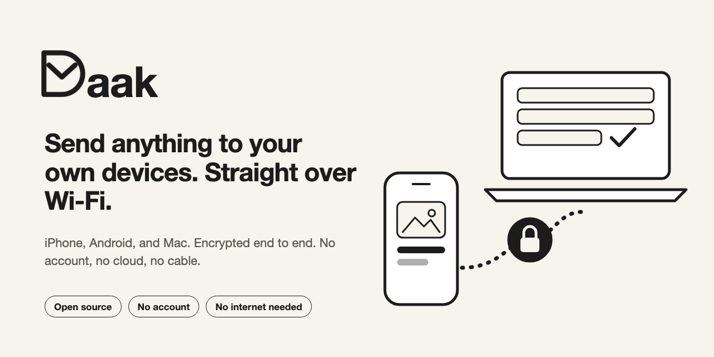
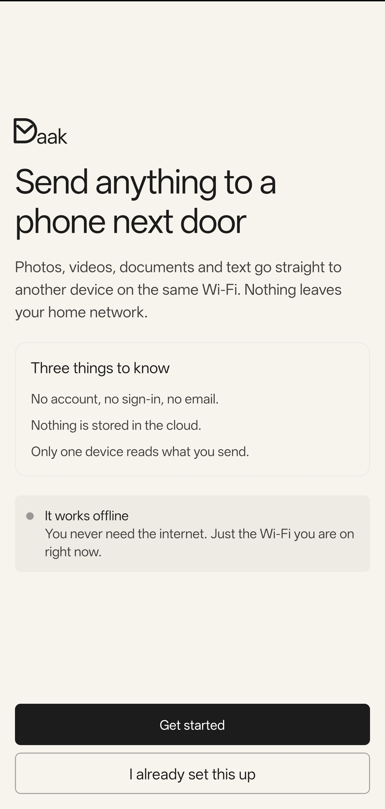
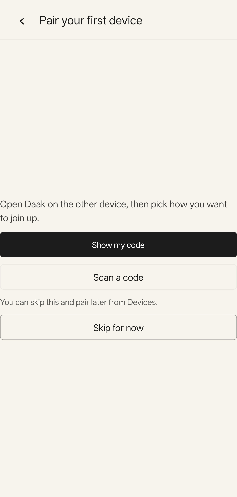
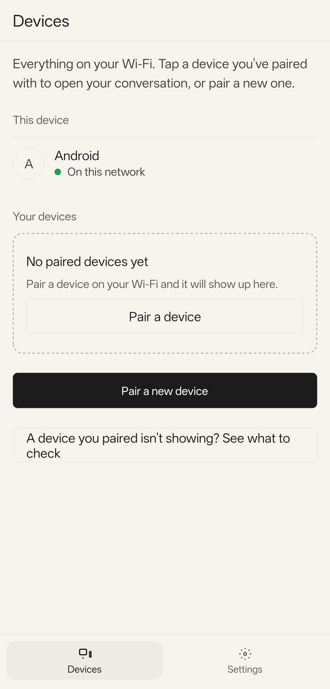
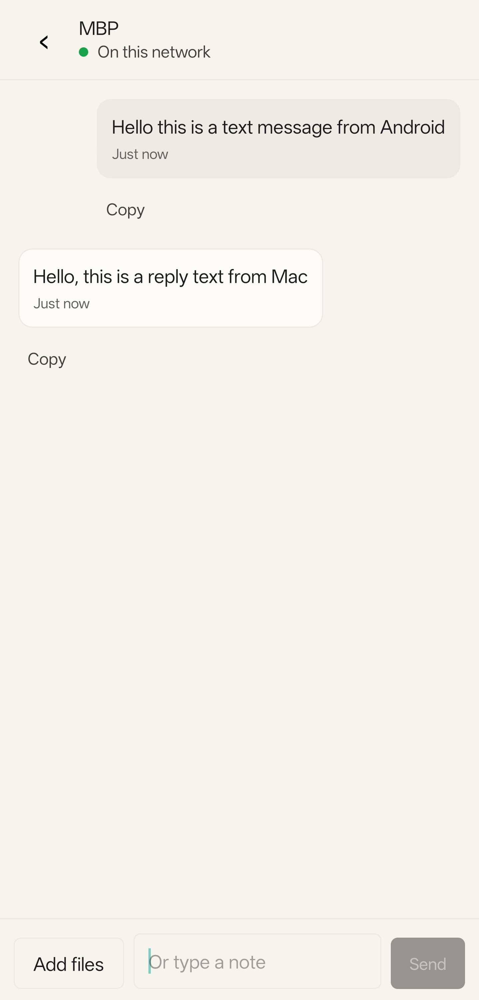
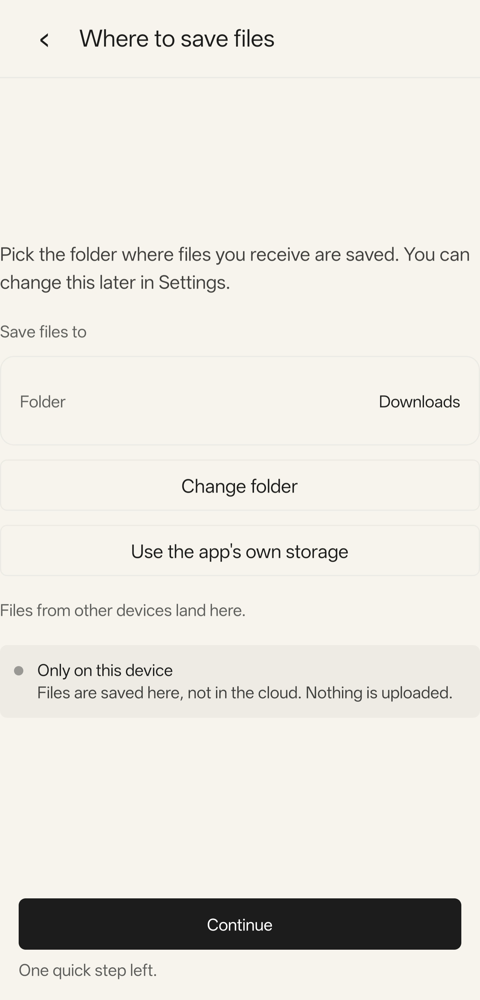
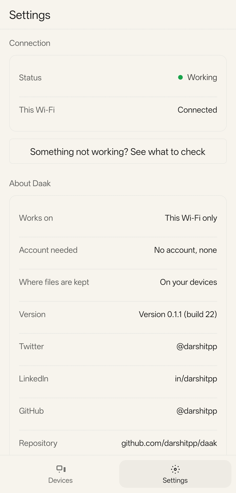

<p align="center">
  
</p>

<p align="center">
  <!-- Add these after the repo is public and has a release and a CI run:
  <a href="https://github.com/darshitpp/daak/releases"></a>
  <a href="https://github.com/darshitpp/daak/actions/workflows/ci.yml"></a>
  -->
  <a href="LICENSE"></a>
</p>

<p align="center">
  <b><a href="https://github.com/darshitpp/daak/releases">Download for Android, macOS, or iOS</a></b>
</p>

<p align="center">
  <a href="https://f-droid.org/packages/dev.darshit.daak/"></a>
  <a href="https://apps.obtainium.imranr.dev/redirect?r=obtainium://app/%7B%22id%22%3A%22dev.darshit.daak%22%2C%22url%22%3A%22https%3A%2F%2Fgithub.com%2Fdarshitpp%2Fdaak%22%2C%22author%22%3A%22darshitpp%22%2C%22name%22%3A%22Daak%22%7D"></a>
</p>

Daak (डाक, "post") moves photos, files, and text between your own
devices over your local network. Nothing goes through the internet. Nothing
goes through a server. You do not create an account.

You have a photo on your phone and you need it on your Mac. You do not want to
email it to yourself, sign in to a cloud app, or find a cable. With Daak, you
pair the two devices once. After that, you pick the item and send it.

> Daak is a fully vibecoded app.

## Try it in 3 steps

1. **Install** Daak on two devices. [Get it here](#install).
2. **Pair** them once. Scan a QR code and check that both screens show the same number.
3. **Send.** Pick a photo, file, or text. It arrives on the other device.

## Screenshots

These are from the Android app.

| | | |
| :---: | :---: | :---: |
| <br>Welcome | <br>Pair a device | <br>Devices |
| <br>Send and receive | <br>Where files go | <br>Settings |

## Why Daak

| You want | Daak gives you |
| --- | --- |
| To send between an iPhone, an Android phone, and a Mac | One app on all three. No platform lock-in. |
| To keep your data private | End-to-end encryption. Your data never leaves your Wi-Fi. |
| No sign-up | No account, no email, no phone number. |
| To send a big video | Daak streams in 1 MiB chunks, so size is not a problem for memory. |
| To send when the other device is away | Daak queues the item and sends it when the device returns. |
| To know the file arrived intact | Daak checks every item. A bad file goes to quarantine, not to your folder. |
| To trust the code | The source is open under Apache 2.0. Read it, or build it yourself. |

## Contents

- [Try it in 3 steps](#try-it-in-3-steps)
- [Screenshots](#screenshots)
- [Why Daak](#why-daak)
- [Supported systems](#supported-systems)
- [Install](#install)
- [Pair two devices](#pair-two-devices)
- [Send and receive](#send-and-receive)
- [Troubleshooting](#troubleshooting)
- [What Daak does not do](#what-daak-does-not-do)
- [Build from source](#build-from-source)
- [Contributing](#contributing)
- [Security](#security)
- [License](#license)

## Supported systems

| System | Minimum version | Release file |
| --- | --- | --- |
| Android | Android 8.0 (API 26) | `.apk` |
| iOS | iOS 16 | `.ipa` (you sign it yourself) |
| macOS | macOS 14 (Sonoma) | `.dmg` |

Windows and Linux are not released.

## Install

Download the file for your system from the
[Releases page](https://github.com/darshitpp/daak/releases).

Daak is not in the Play Store or the App Store. The release files are not
signed with a paid developer account. Each system shows a warning. Follow the steps for your
system.

### Android

1. Download an APK from the latest release on your phone. Pick the file by the
   end of its name:

   | The name ends with | Use |
   | --- | --- |
   | `-arm64-v8a.apk` | A modern 64-bit phone |
   | `-armeabi-v7a.apk` | An older 32-bit phone |
   | `-universal.apk` | You do not know the phone type |

2. Open the file from the notification or from the **Downloads** app.
3. Android asks you to allow installs from this source. This setting is
   called **Install unknown apps**. Tap **Settings**, then turn on **Allow
   from this source** for the app that opened the file (for example Chrome or
   Files). Then go back and tap **Install**.
4. Google Play Protect can show "App blocked" or "Unknown developer". Tap
   **More details**, then **Install anyway**. Play Protect shows this because
   Daak is not in the Play Store. It does not mean that the file is bad.
5. After the install, turn **Allow from this source** off again for that app.

Daak asks for **Camera** (to scan a QR code) and **Notifications** (to show a
received item) when it needs them.

To update, install the new APK over the old one. Your pairings stay. You must
use a file signed with the same key (see the check below). Android refuses an
update that another key signed.

To verify the signer before you install, run `apksigner verify --print-certs <apk>`.
The printed `SHA-256 digest` must be:

```text
0d825cdc0069c9176bc9232f4be5a5266d51888f54c8fc2ff123c5b41f8f9df5
```

A different digest means a different key signed the file. Do not install it.

#### F-Droid

Install [F-Droid](https://f-droid.org), search for **Daak**, and install it. Or
open the [Daak page on F-Droid](https://f-droid.org/packages/dev.darshit.daak/).
F-Droid publishes the APK that the Daak upload key signed. This is the same
key as the GitHub APK. So you can update between GitHub and F-Droid.

#### Obtainium

[Obtainium](https://obtainium.imranr.dev) installs and updates apps straight
from GitHub Releases. Tap the Obtainium badge at the top of this page on your
phone, or add `https://github.com/darshitpp/daak` as a source in Obtainium.
Each release has 3 APKs. Obtainium offers the universal APK and the APK for the
CPU of your phone, and it selects the APK for your CPU. Keep that choice.

### macOS

1. Open the downloaded `.dmg` file.
2. Move `Daak.app` to the Applications folder.
3. Open `Daak.app` for the first time with one of the methods below.

Apple has not notarized the app, so Gatekeeper blocks the first open. This is
expected. Use the method for your macOS version.

- **macOS 14 (Sonoma):** right-click `Daak.app`, choose **Open**, then choose
  **Open** in the dialog.
- **macOS 15 (Sequoia) and later:** the right-click method no longer works.
  Open the app once and close the warning. Then open **System Settings >
  Privacy & Security**, scroll to **Security**, and click **Open Anyway** next
  to the Daak message. Enter your password, then choose **Open**.
- **Any version:** remove the quarantine flag in Terminal, then open the app:

  ```bash
  xattr -dr com.apple.quarantine /Applications/Daak.app
  ```

Do this one time. Later opens work as normal. A new download of the app is
quarantined again, so repeat the step after each update.

macOS asks for **Local Network** access the first time Daak looks for devices,
and for **Camera** access when you scan a QR code. Choose **Allow** for both.
If you chose **Don't Allow** by mistake, turn Daak on in **System Settings >
Privacy & Security > Local Network**.

Daak receives files only while the app is running. A transfer stops when you
quit the app.

To check a download, run `shasum -a 256 <file>`. The value must equal the
SHA-256 digest that GitHub shows next to the file on the release page.

#### Homebrew

```bash
brew install --cask darshitpp/tap/daak
```

Apple has not notarized the app, so Gatekeeper blocks the first open. Remove
the quarantine flag once:

```bash
xattr -dr com.apple.quarantine /Applications/Daak.app
```

If you already copied `Daak.app` to the Applications folder from the `.dmg`,
Homebrew stops with "It seems there is already an App". Quit Daak and delete
`/Applications/Daak.app` first. Then run the install command again.

To update, run `brew upgrade --cask daak`. Then remove the quarantine flag
again.

### iOS

The `.ipa` file has no signature, and Apple does not allow it in the App
Store. You install it by sideloading. A sideloading tool signs the file with
your own free Apple ID, then installs it on your iPhone. Use one of these
tools:

| Tool | What it needs |
| --- | --- |
| [SideStore](https://sidestore.io) | A computer for the first setup only. Then the iPhone refreshes the app on its own. |
| [AltStore](https://altstore.io) | AltServer running on a Mac or a Windows PC on the same Wi-Fi as the iPhone. |
| [Sideloadly](https://sideloadly.io) | A Mac or a Windows PC and a USB cable, for each install and each refresh. |

Each tool has its own setup guide. Follow the guide of the tool that you pick.
The steps for Daak are the same for all three tools.

1. On your iPhone, turn on **Developer Mode**: **Settings > Privacy & Security >
   Developer Mode**. The iPhone restarts. Confirm after the restart. This
   option appears only after a sideloading tool has connected to the iPhone.
2. Install the tool that you picked and sign in with your Apple ID.
3. Download the `.ipa` file to the iPhone or to the computer.
4. Give the `.ipa` to the tool and install it.
5. If iOS says "Untrusted Developer", open **Settings > General > VPN & Device
   Management**, tap your Apple ID, and tap **Trust**.
6. Open Daak. When iOS asks for **Local Network** access, choose **Allow**.
   Without it, Daak cannot find other devices. Also allow **Camera** to scan a
   QR code and **Notifications** to see received items.

A free Apple ID profile lasts 7 days. After 7 days, the app stops opening.
Refresh it in the same tool before that time. SideStore and AltStore can
refresh in the background. Your pairings and data stay on the device when you
refresh. A free Apple ID can keep 3 sideloaded apps at one time.

The tool changes the bundle id of the app to make it unique for your Apple ID.
This is normal. If you delete the app, its pairings and data go with it.

An iPhone cannot send the presence signal that tells other devices it is
online, so the iPhone can show as offline on your other devices. Sends to it
still queue and arrive when Daak is open on the iPhone.

The iOS share sheet cannot send a file to Daak. Open Daak and add the item there.

## Pair two devices

You pair two devices one time. Both devices must be on the same network.

1. Open Daak on both devices.
2. On the first device, choose to add a device. It shows a QR code.
3. On the second device, scan the QR code. If you cannot scan, use the
   short code.
4. Both devices show a 6-digit number. If the numbers match, press
   **They match** on both devices.

If the numbers do not match, reject the pairing. Someone else can be on your
network.

A new pairing stays pending until you confirm it.

## Send and receive

1. Open a paired device in Daak.
2. Add text, a file, a photo, or a video.
3. Send.

The other device shows a notification. On iPhone and Android, received photos
and videos go to Photos or the Gallery. Other received files go to the save
folder that you choose in **Settings**. On iPhone, Daak asks once for
permission to add photos.

If the other device is not reachable, Daak queues the item. It retries
with a growing delay until the device returns.

## Troubleshooting

| Problem | Cause | What to do |
| --- | --- | --- |
| A device does not appear | The devices are on different networks, or the router blocks device-to-device traffic | Join both devices to the same network. Turn off "AP isolation" or "client isolation" in the router. Guest networks often block it. |
| A device does not appear on iPhone | Local Network permission is off | Open **Settings > Daak** and turn on **Local Network**. |
| The send stays in the queue | The other device is asleep, closed, or away | Open Daak on the other device. The queue sends on its own. |
| An item is in quarantine | The received data did not match its checksum | Send the item again from the sending device. The receiver cannot ask for it again. |
| The iOS app does not open | The 7-day profile expired | Sign the `.ipa` again. |
| macOS says the app is damaged, or cannot be opened | The app is not notarized | Use **Open Anyway** or the `xattr` command in [Install](#macos). |
| Android says "App blocked" | Google Play Protect does not know the developer | Tap **More details**, then **Install anyway**. |
| A device you removed still shows as paired | The other device was offline when you unpaired | It learns about the unpair when it returns. Until then, remove the pairing on that device by hand. |

## What Daak does not do

- Daak does not send data over the internet.
- Daak does not back up your files.
- Daak is not a chat app. It has no read receipts and no groups.
- Daak does not keep transfers running on desktop after you quit the app.
- Daak does not support Windows or Linux releases.

## Build from source

You need these tools:

- Rust (stable) and `cargo`
- Node.js and `pnpm` 9
- Xcode (for iOS and macOS) or Android Studio with the Android SDK and NDK (for Android)

```bash
git clone https://github.com/darshitpp/daak.git
cd daak
pnpm install
cargo test --workspace
pnpm -r typecheck
pnpm -r test
```

Native build steps for each system are in
[`apps/mobile/README.md`](apps/mobile/README.md).

## Contributing

Bug reports, ideas, and pull requests are welcome. Read
[CONTRIBUTING.md](CONTRIBUTING.md) first.

## Security

Do not report a security problem in a public issue. Use
[private vulnerability reporting](https://github.com/darshitpp/daak/security/advisories/new)
on GitHub.

## License

Daak uses the [Apache License 2.0](LICENSE).

You can use, change, and share the code, including in a commercial product. You
must keep the copyright notice and the [NOTICE](NOTICE) file. You must say what
you changed.

Copyright 2026 Darshit Patel.
